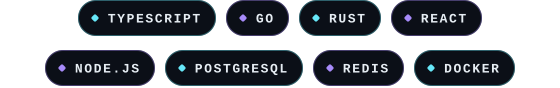

<div align="center">



# profile-forge

**An animated GitHub profile README from one JSON file.**

Edit `profile.config.json`, push, and a GitHub Action rebuilds your profile:
an animated header, project cards, a featured-project panel, link buttons and a toolkit.

[Quick start](#quick-start) · [Themes](#themes) · [Config reference](#config-reference) · [Full example](examples/neon/README.md)

</div>

## Why

- **No third-party services.** Everything is an SVG committed to your own repo. No badge server to go down, rate-limit you or track your visitors.
- **Actually animated.** Stars twinkle, the grid flies forward, taglines rotate, artwork moves. It is all CSS inside the SVGs, so it plays on GitHub, and it switches off for visitors who prefer reduced motion.
- **One file to edit.** Your name, links, projects and stack live in `profile.config.json`. You never touch SVG or HTML.
- **Text that fits.** Long names shrink, descriptions wrap to two lines, and anything too long ends in an ellipsis instead of spilling out of its card.
- **Zero dependencies.** One Node script, nothing to install.

<p align="center">

</p>
<p align="center">


</p>
<p align="center">

</p>

## Quick start

1. Click **Use this template** → **Create a new repository**, and name the repository **exactly your GitHub username**. That special repo is what GitHub shows on your profile. Make it public.
2. In your new repo, open `profile.config.json`, replace the sample details with yours, and commit.
3. Wait about a minute. The **Build profile** Action regenerates `README.md` and `assets/`, and your profile is live.

Every later change is the same: edit the config, commit, done.

Already have a profile repo? Copy `build.mjs`, `src/`, `profile.config.json` and `.github/workflows/build-profile.yml` into it. The build replaces `README.md`, so save anything you want to keep first.

### Preview on your machine

```bash
node build.mjs --out preview
```

This writes `preview/README.md` and `preview/assets/` without touching your real README. Open the SVGs in a browser, or the README in any Markdown preview. Add `--theme ember` to try a theme without editing the config. Needs Node 18 or newer.

## Themes

Set `"theme"` to one of these.

| `neon` (default) | `ember` |
| --- | --- |
|  |  |
| **`aurora`** | **`paper`** |
|  |  |

Full pages: [neon](examples/neon/README.md) · [ember](examples/ember/README.md) · [aurora](examples/aurora/README.md) · [paper](examples/paper/README.md)

### Your own colours

Give `theme` an object instead of a name. Start from any built-in theme and override what you like:

```json
"theme": { "base": "neon", "a1": "#facc15", "a2": "#fb7185" }
```

| Token | Used for |
| --- | --- |
| `a1`, `a2`, `a3` | Accent colours: name gradient, borders, icons, link buttons |
| `bg0`, `bg1`, `bg2` | Header background gradient |
| `panel` | Card, chip and button backgrounds |
| `ink`, `soft`, `muted` | Headings, taglines, secondary text |
| `line` | Hairlines and card borders |
| `ok` | The "live" dot |
| `star`, `glint`, `onAccent` | Header stars, divider highlight, text on accent fills |

Colours must be 6-digit hex.

## Config reference

Only `name` is required. Leave out any section and it disappears from the profile.

| Key | What it does |
| --- | --- |
| `name` | Your name, in the header. Long names shrink to fit. |
| `theme` | A theme name or an object of colour overrides. Default `neon`. |
| `taglines` | Lines that take turns under your name (up to 8). |
| `status` | Short text at the top left of the header, beside a pulsing dot. |
| `location` | Short text at the top right of the header. |
| `links` | Buttons under the header: `{ "label", "text", "url" }` (up to 6). |
| `about` | `intro` (a paragraph of Markdown) and `rows`: `{ "label", "value" }` pairs shown as a table. |
| `featured` | The big panel for your main project. See below. |
| `projects` | Project cards, two per row (up to 12). See below. |
| `toolkit` | Names shown as chips. |
| `activity` | `{ "streak": true }` adds a contribution-streak badge. Needs `github`. |
| `github` | Your username. Only used by the streak badge. |
| `footer` | Text for the closing rule. |
| `sections` | Rename headings: `{ "about", "featured", "projects", "toolkit", "activity" }`. |
| `credit` | `false` removes the "Built with profile-forge" line. |

`about.rows` values understand `**bold**`, `` `code` `` and `[links](https://…)`. Links must start with `https://`, `http://` or `mailto:`.

### `featured`

```json
"featured": {
  "name": "Driftboard",
  "url": "https://example.com",
  "summary": "A realtime planning board for small teams.",
  "art": "orbit",
  "lead": { "title": "Realtime boards", "text": "Every card, comment and cursor syncs the moment it changes" },
  "features": [
    { "icon": "bolt", "title": "Instant sync", "text": "Conflict-free edits over WebSockets" }
  ],
  "stack": ["TypeScript", "Go"],
  "demo": "https://example.com",
  "source": "https://github.com/you/driftboard"
}
```

- **`art`** is the animation in the large tile: `orbit` (default), `qr` or `bars`.
- **`lead`** is the text in the large tile.
- **`features`** takes 1 to 4 tiles; the layout adapts to the count.
- **`icon`** is one of: `bolt` `shield` `chart` `code` `globe` `database` `rocket` `users` `bell` `lock` `search` `terminal` `screen` `receipt` `grid` `calendar`.

### `projects`

```json
{
  "name": "Pingfold",
  "tag": "Open source · MIT",
  "description": "Share a local dev server over a secure tunnel with one command and no account.",
  "stack": ["Go", "QUIC", "Docker"],
  "url": "https://github.com/you/pingfold",
  "demo": "https://example.com"
}
```

- **`url`** is where the card links. **`demo`** adds the project to the "Live" line under the cards and switches on its **LIVE** badge.
- Set **`"live"`** to `true` or `false` to control the badge yourself.
- Keep descriptions to a sentence: two lines fit, the rest is cut with an ellipsis.

## Good to know

- **The streak badge is the one exception to "no third parties".** It is off by default; turning it on loads an image from [streak-stats.demolab.com](https://streak-stats.demolab.com), coloured to match your theme.
- **Fonts are the visitor's system fonts**, because GitHub blocks web fonts inside README images. Text widths are estimated at build time, so on an unusual font a line may end a little early.
- **Dark themes look best on GitHub's dark mode** but are self-contained panels, so they read fine on light mode too. `paper` is the light option.
- **Builds are deterministic.** The star field and QR pattern are seeded from your name, so rebuilding without changes produces no diff.
- You can delete `examples/`, `scripts/` and `test/` from your own repo. The build only needs `build.mjs`, `src/` and the workflow.

## Development

```bash
node --test          # run the tests
npm run examples     # rebuild examples/ for every theme
```

The generator is plain ES modules with no dependencies: `src/svg.mjs` draws the images, `src/readme.mjs` writes the README, `src/config.mjs` validates the config and `src/themes.mjs` holds the colours. New themes, icons and artwork are welcome; each is a small addition to one file.

## Credits

Started as the generator behind [rajithdev](https://github.com/rajithdev)'s profile, which used it until November 2026. Released under the [MIT License](LICENSE).
