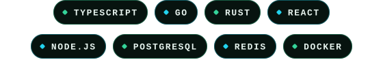

  

&nbsp;
&nbsp;

 

### `01` &nbsp;About

I build tools that make teams faster: realtime collaboration, developer tooling, and the boring infrastructure underneath.

<table>
<tr><td><code>BUILDING</code></td><td><b>Driftboard</b> — a realtime planning board for small teams</td></tr>
<tr><td><code>MAINTAINING</code></td><td><a href="https://example.com">Pingfold</a> and a handful of smaller libraries</td></tr>
<tr><td><code>FOCUS</code></td><td><b>TypeScript</b>, <b>Go</b>, <b>PostgreSQL</b> and <b>WebSockets</b></td></tr>
<tr><td><code>BASE</code></td><td><b>Lisbon, Portugal</b></td></tr>
</table>

### `02` &nbsp;Featured build — [Driftboard](https://example.com)

A realtime planning board for small teams.

**Stack** &nbsp;<code>TypeScript</code> <code>Go</code> <code>PostgreSQL</code> <code>WebSockets</code> &nbsp;·&nbsp; [**Live demo ↗**](https://example.com) &nbsp;·&nbsp; [**Source ↗**](https://github.com/your-username/driftboard)

### `03` &nbsp;More builds

**Live** &nbsp;[Pingfold ↗](https://example.com) &nbsp;·&nbsp; [Tessera UI ↗](https://example.com)

### `04` &nbsp;Toolkit

 

Built with <a href="https://github.com/rajithdev/profile-forge">profile-forge</a>

